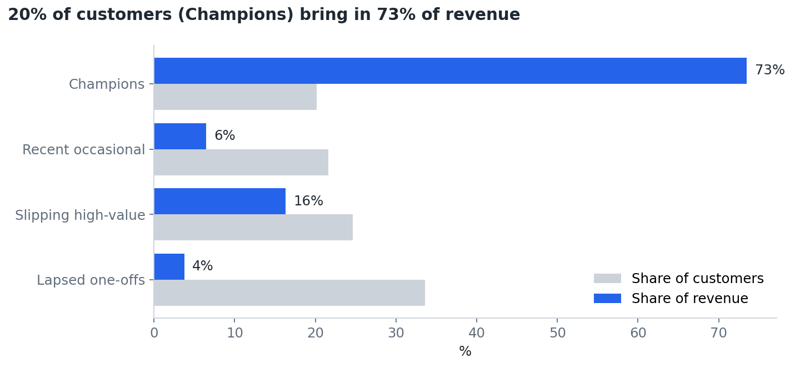
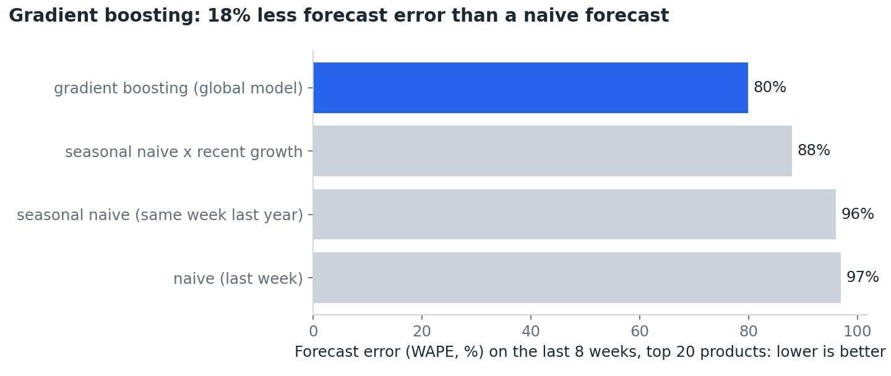
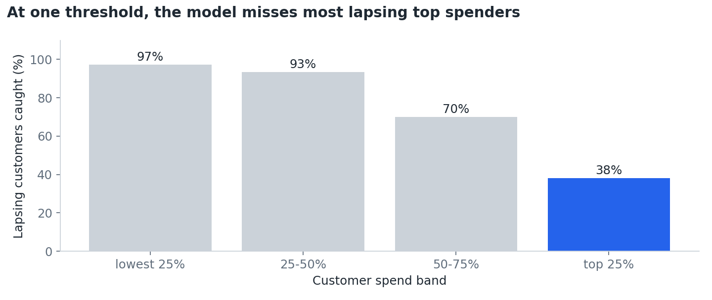

# Retail member insights: segmentation, lapse prediction and demand forecasting


**Live app:** _add your Streamlit Community Cloud link here_ · **Stack:** SQL (DuckDB / Spark SQL on Databricks), Python
(pandas, scikit-learn), MLflow, Streamlit, pytest, GitHub Actions

Two years of transactions from a UK online retailer (1.07m rows) turned into three decision tools: **who our customers
are**, **which valuable customers are about to stop buying**, and **how much stock to plan for the next 8 weeks**,
plus a check that the model treats every customer group fairly.



## The problem I solved
A retail CRM or membership team needs to know where to spend a limited retention budget, and a buying team needs a
forecast better than "same as last week". The raw data couldn't answer either question: 23% of rows had no customer
ID, about 30,000 rows were cancellations or orders that were later cancelled, and 25,728 rows were exact duplicates.
Analysed as it was, the data would have made two customers look like the biggest spenders, purely because of large
orders that were later reversed.

## The process I optimised
| Before (a typical manual approach) | Now (this pipeline) |
|---|---|
| Spreadsheet exports cleaned by hand, with rules applied inconsistently | **Layered SQL**: bronze (raw) → silver (clean) → gold (customer and weekly marts), the same layers on Databricks Delta tables |
| Excluded rows disappear silently | Every excluded row is **counted by reason** in a data-quality log, and the run **fails** if counts don't reconcile |
| Segments defined by gut feel | **k-means** on recency, frequency and spend, with *k* chosen by silhouette score and segments named by rules |
| A list of "inactive" customers after they have already gone | A **lapse model** that scores every customer *before* they leave |
| Forecast = last week's sales | A **global gradient-boosting forecast** tested on a hold-out against three baselines |
| Re-running means redoing the work | `python src/models.py` rebuilds everything from 1.07m raw rows in **about 6 seconds**; 3 automated tests run in CI on every push |

## The results I got
**Data quality.** 1,067,371 raw rows → **767,349 clean sales lines**. Removed: 242,257 with no customer ID, 25,728 exact
duplicates, 19,494 cancellations, **9,915 order lines matched to a later cancellation** (a rule I added after two customers
showed £168k and £77k of "spend" that had been fully reversed), 2,560 postage, fee and adjustment codes, and 68 zero-price lines.

**Segments (5,838 customers, £16.3m revenue over two years).**

| Segment | Customers | Median days since last order | Median orders | Share of revenue |
|---|---|---|---|---|
| Champions | 1,178 (20%) | 17 | 13 | **73%** |
| Recent occasional | 1,261 (22%) | 24 | 3 | 6% |
| Slipping high-value | 1,438 (25%) | 185 | 4 | **16%** (£2.66m) |
| Lapsed one-offs | 1,961 (34%) | 401 | 1 | 4% |

**Lapse prediction.** Trained on customers' history before 1 Sep 2011; label = no purchase in the next 90 days (base rate 57%).

| Model | ROC AUC | Precision | Recall | F1 |
|---|---|---|---|---|
| Logistic regression | 0.80 | 0.74 | 0.82 | 0.78 |
| Decision tree (depth 4) | 0.80 | 0.72 | 0.83 | 0.77 |
| **Gradient boosting** | **0.82** | **0.75** | **0.83** | **0.79** |

**Demand forecast (top 20 products, 8-week hold-out from 3 Oct 2011).**



The global gradient-boosting model has **18% less forecast error (WAPE) than a naive forecast** and 17% less than the
same week last year: **15,770 fewer units** forecast wrongly over 8 weeks, about **£17,000** of stock at average sale price.

**Responsible AI: the finding that changes the recommendation.**



With one 0.5 threshold, the model catches 97% of lapsing low spenders, but only **38% of lapsing top-25% spenders**, the
customers worth the most, while flagging 86% of *loyal* low spenders by mistake. A single threshold would send most of
the retention budget to the wrong people. Lowering the top-spend threshold to 0.3 raises recall for that group to **69%**,
with 26% of loyal top spenders flagged.

### Recommendations
1. **Protect the Champions.** 20% of customers bring in 73% of revenue: give them a named account owner and early access to offers.
2. **Win back the 408 top-quartile customers flagged at the 0.3 threshold** (£1.81m of spend over two years), using the
   ranked list in the app, before they reach the "Lapsed one-offs" segment.
3. **Use segment-specific thresholds, not one cut-off.** Lower the threshold for high spenders and raise it for low spenders,
   so contact spend follows customer value.
4. **Replace "same as last week" ordering with the global forecast** for the top 20 lines, and review error weekly.
5. **Fix cancellations at source.** Linking each cancellation to its original order line in the order system would remove
   the need for the matching rule.

## Limitations: what I'd do with more data
- **No member data.** There are no demographics or membership status, so fairness is checked by market (UK vs
  international) and spend band only. With member data I would also check age, region and deprivation (IMD).
- **Wholesale-heavy customers.** Many customers are small businesses, so "lapse" partly reflects ordering cycles.
- **One split, one hold-out.** Results vary by a few points with different random splits; next step is time-based
  cross-validation and backtesting the forecast over several origins.
- **Cancellation matching** pairs on customer, product and exact quantity, so partial returns are not matched.
- **Two years of history** gives the forecast only one previous season to learn from.

## How to run
```bash
pip install -r requirements.txt
python src/ingest.py      # downloads UCI Online Retail II (45 MB) and converts it to CSV
python src/models.py      # SQL layers in DuckDB + all models -> outputs/
python src/charts.py      # charts -> screenshots/
pytest -q tests           # data-quality and no-leakage tests
streamlit run app.py
```
**On Databricks (Free Edition):** add this repo as a Git folder, upload `data/raw/online_retail_ii.csv` to the volume
`workspace.default.retail`, and run `notebooks/databricks_pipeline.py`. It builds the same bronze/silver/gold layers as Delta
tables in Spark SQL and logs the three models to MLflow.

## Repo map
`sql/` layered SQL · `src/pipeline.py` runs it and checks data quality · `src/models.py` models ·
`notebooks/databricks_pipeline.py` Databricks version · `app.py` Streamlit app · `outputs/` results ·
[`data_dictionary.md`](data_dictionary.md) · [`MODEL_CARD.md`](MODEL_CARD.md) · [`data/README.md`](data/README.md)
